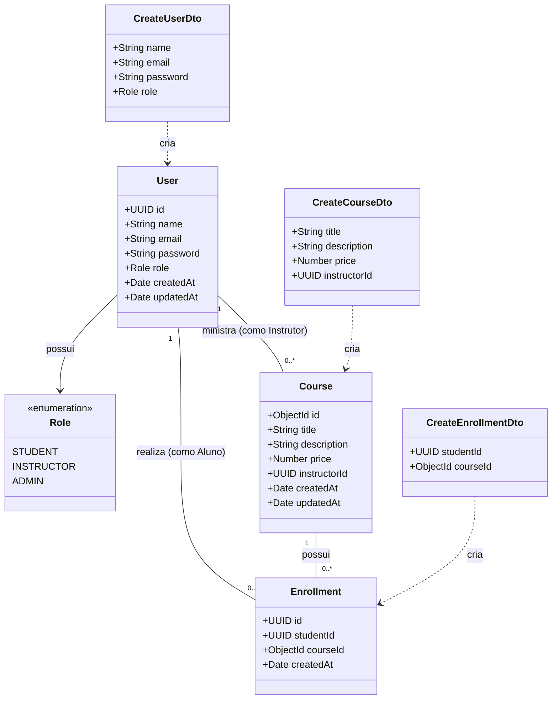
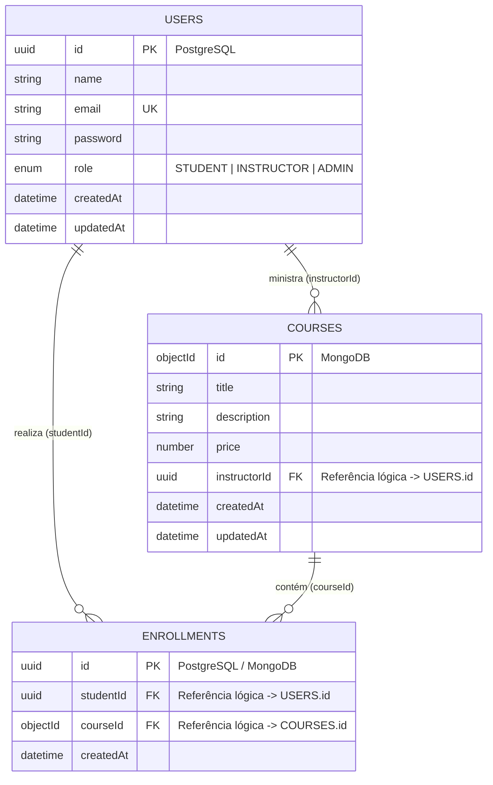
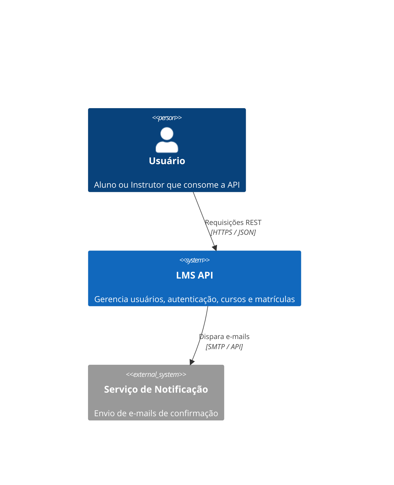
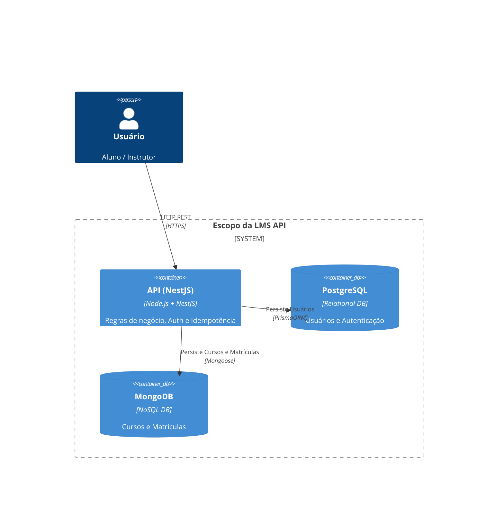
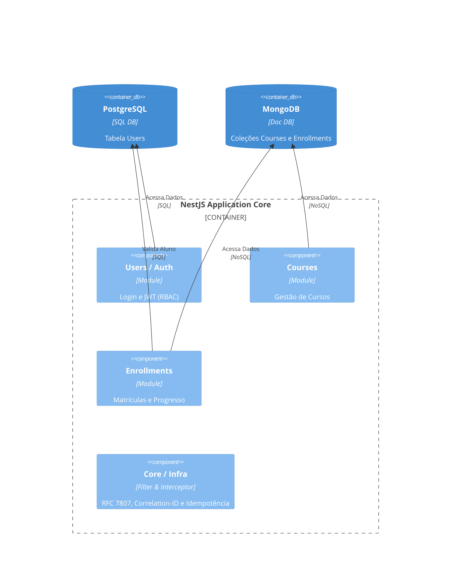

<p align="center">
  <a href="http://nestjs.com/" target="blank"></a>
</p>

# 🎓 LMS API - Plataforma de Gestão de Aprendizado

API RESTful escalável para gerenciamento de cursos, alunos e matrículas desenvolvida com **NestJS**. O projeto implementa uma **Arquitetura em Camadas** combinada com **Persistência Poliglota** (_Polyglot Persistence_), utilizando **PostgreSQL** para dados transacionais e **MongoDB** para dados dinâmicos.

---

## 📌 Checklist de Requisitos do Projeto

Abaixo está o mapeamento dos requisitos solicitados para a entrega:

- **[x] Arquitetura Definida:** Arquitetura em Camadas (Controllers, Services, Repositories/Models).
- **[x] Modelagem de Dados:** Estrutura relacional (PostgreSQL) e não-relacional (MongoDB) integrada.
- **[x] Autenticação e Autorização:** JWT com controle de acesso baseado em papéis (RBAC - _STUDENT vs INSTRUCTOR_).
- **[x] Resiliência e Idempotência:** Exigência do cabeçalho `idempotency-key` em rotas `POST` críticas.
- **[x] Tratamento Global de Exceções:** Exception Filter padronizando respostas em **RFC 7807 (Problem Details)**.
- **[x] Observabilidade Básica:** Interceptor de logs estruturados em JSON com rastreamento via `Correlation-ID`.
- **[x] Controle de Vazão:** _Rate Limiting_ ativado em rotas de autenticação e rotas públicas.
- **[x] Contrato de API:** Documentação viva via **OpenAPI / Swagger** acessível em `/api/docs`.
- **[x] Infraestrutura como Código:** `docker-compose.yml` para subida da API e dos bancos com um único comando.
- **[x] Documentação Arquitetural:** Diagramas de Contexto, Contêineres e Componentes no modelo **C4 Model**.

---

## 📊 Modelagem de Dados

### 1. Diagrama de Classes UML

Diagrama representando as entidades do domínio, enums, DTOs de entrada validados com `class-validator` e seus relacionamentos:



---

### 2. Diagrama Entidade-Relacionamento (DER / ERD)

Visão lógica da integração poliglota entre o modelo relacional (PostgreSQL) e o modelo orientado a documentos (MongoDB):



---

## 🏛️ Documentação Arquitetural (C4 Model)

### 1. Diagrama de Contexto (System Context)



---

### 2. Diagrama de Contêineres (Containers)



---

### 3. Diagrama de Componentes (Components)



---

## 💡 Decisões de Arquitetura e Justificativa de Bancos

- **PostgreSQL (Relacional):** Escolhido para **Usuários** e **Autenticação** por exigir garantias **ACID**, consistência forte, e-mails únicos e integridade referencial nativa.
- **MongoDB (Não-Relacional):** Escolhido para **Cursos** e **Matrículas**, permitindo esquema flexível para conteúdos dinâmicos (aulas, vídeos, quizzes) e buscas rápidas em documentos aninhados sem dependência de `JOINs` custosos.

---

## 🛠️ Infraestrutura e Execução

### 1. Subir Infraestrutura (Docker Compose)

Suba a API e os bancos de dados (PostgreSQL + MongoDB) com um único comando:

```bash
docker compose up -d

```

### 2. Executar a Aplicação Localmente

```bash
# Instalar dependências
npm install

# Modo de desenvolvimento
npm run start:dev

```

### 3. Documentação Swagger (OpenAPI)

Após iniciar a aplicação, acesse o contrato interativo da API no navegador:

- `http://localhost:3000/api/docs`

---

## 🧪 Testes

```bash
# Testes unitários
npm run test

# Testes End-to-End (E2E)
npm run test:e2e

# Cobertura de testes
npm run test:cov

```
--- 
## 📝 Licença

Este projeto está sob a licença [MIT](LICENSE).
