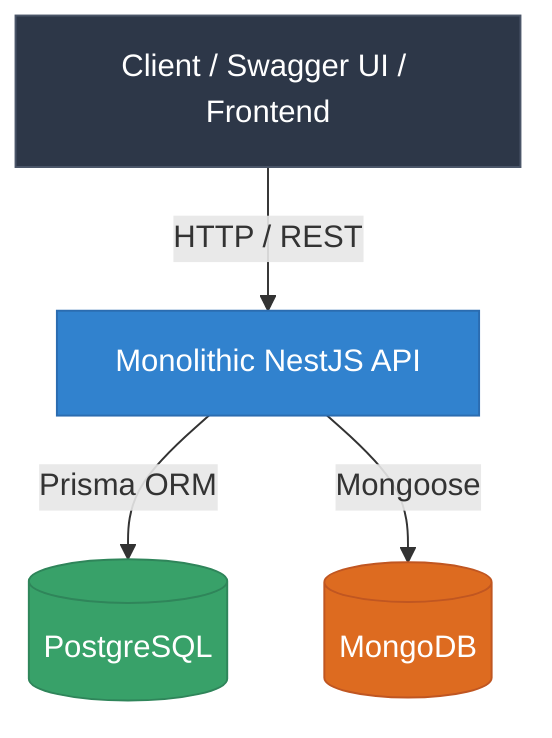
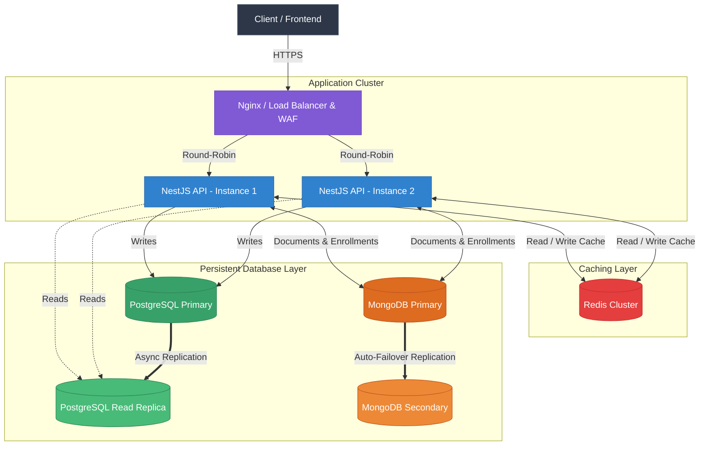

# 📄 API Architecture Optimization Report (LMS)

> This document describes a proposed architectural evolution. The tactics in the table are recommendations and are not necessarily implemented features of the current API.

---

## 1. Current Architecture Analysis

### Current Architecture Diagram

Currently, the Learning Management System (LMS) API operates under a simplified monolithic architecture containerized via Docker:

### Key Components:

* **Clients:** Frontend application and Swagger UI consuming endpoints via HTTP/REST calls.
* **Application (NestJS API):** Single instance responsible for processing business logic, JWT authentication, exception handling (RFC 7807), and idempotency middleware.
* **Polyglot Persistence (Databases):**
* **PostgreSQL (Prisma ORM):** Stores relational data for users and authentication.
* **MongoDB (Mongoose):** Stores documents for courses, contents, and enrollments.

### Identified Architectural Risks and Bottlenecks:

1. **Single Point of Failure / SPOF (Availability & Fault Tolerance):** Only one NestJS container is running. If a memory leak, unhandled runtime exception, or infrastructure failure occurs, the entire platform becomes completely unavailable.
2. **Relational Database Bottleneck (Performance):** Every authentication check and data fetch queries the primary database directly. High traffic leads to disk I/O spikes and increased API latency.
3. **Limited Scalability & Missing Load Distribution (Scalability):** The lack of a load balancer prevents horizontal traffic distribution across multiple API instances during concurrent request spikes.

---

## 2. Proposed Target Architecture

To handle growing user demand, reduce latency, eliminate single points of failure, and guarantee service continuity, the following architectural evolution is proposed:

### Components of the New Architecture:

* **Nginx (Load Balancer & Reverse Proxy):** Operates at the edge handling SSL Termination, Web Application Firewall (WAF) filtering, and traffic distribution.
* **NestJS API Cluster:** Replicated, stateless API instances running in independent containers.
* **Redis Cluster (In-Memory Cache):** Ultra-low latency distributed caching layer for session management, temporary data, and high-read route responses.
* **PostgreSQL Primary & Read Replica:** Separation of read and write operations to optimize relational database performance.
* **MongoDB Replica Set:** Cluster with automatic failover and secondary replication ensuring course document persistence.

---

## 3. Architectural Rationale & Trade-offs

The following table details the architectural tactics applied in the proposal, structured across the four required categories:

| Category | Architectural Tactic | Application Point | Identified Problem | Proposed Solution | Expected Benefit | Component Unavailability Risk |
| --- | --- | --- | --- | --- | --- | --- |
| **Performance** | **Caching** | Between NestJS API & Databases | Excessive repetitive read queries (courses, catalogs, user profiles) causing high latency. | Implementation of a **Redis Cluster** to keep frequently accessed data in RAM. | Drastic response latency reduction and database disk I/O relief. | If Redis fails, the API gracefully falls back to querying databases directly (slight performance degradation). |
| **Performance** | **Replication** | Relational Database Layer (PostgreSQL) | Database locks and performance degradation due to concurrent heavy read/write loads on PostgreSQL. | Provisioning a **Read Replica** dedicated exclusively to read/search operations. | Higher parallel request throughput and isolation of write locks from read workflows. | If the replica fails, the API temporarily redirects read queries back to the primary node. |
| **Availability** | **Load Balancer** | Edge / Ingress Layer | Single point of failure at the web layer and inability to absorb large request volumes on a single node. | **Nginx** configuration as a Load Balancer using the *Round-Robin* algorithm. | Uniform traffic distribution and assurance that single-container crashes do not cause downtime. | Nginx health checks detect offline containers and re-route 100% of traffic to healthy nodes. |
| **Availability** | **Failover** | NoSQL Cluster (MongoDB Replica Set) | Total course/enrollment module outage if the primary MongoDB server crashes. | Configuration of a **Replica Set** with automated primary node election and promotion. | Automatic business continuity for document storage without human intervention. | Minimal millisecond-level election window during primary node switchover. |
| **Resilience** | **Rate Limiting** | NestJS API (`ThrottlerModule`) | Risks of infrastructure overload from Denial of Service (DDoS) attacks or abusive API consumption. | Application of IP/token-based request throttling over configurable time windows. | Compute resource protection and safeguarding system stability against traffic spikes. | Legitimate clients exceeding quotas temporarily receive `429 Too Many Requests`. |
| **Resilience** | **Idempotency** | Interceptors on write endpoints (`POST /courses`, `/enrollments`) | Risk of duplicate entity creation or enrollment actions caused by client network retries. | Persist the `idempotency-key` and associate it with the request result. | Reduce duplicate effects caused by client retries. | Requires key persistence and expiration; the current implementation only requires the header and does not deduplicate calls. |
| **Security** | **RBAC (Role-Based Access Control)** | NestJS Guards (`RolesGuard`, `JwtAuthGuard`) | Unauthorized access to sensitive admin routes (e.g., students attempting to create courses). | Strict JWT claim verification mapped to user roles (`STUDENT` / `INSTRUCTOR`). | Principle of Least Privilege enforcement and sensitive endpoint security. | Requests lacking required roles are blocked at ingress with `403 Forbidden`. |
| **Security** | **WAF / HTTPS Offloading** | Nginx (Reverse Proxy) | Direct exposure of Node.js runtime to the web; vulnerability to SQL Injection and XSS. | Malicious traffic filtering and centralized TLS/SSL termination at Nginx. | Enhanced application security and guaranteed HTTPS encryption in transit. | Malformed or malicious traffic is rejected at the edge before reaching backend APIs. |
