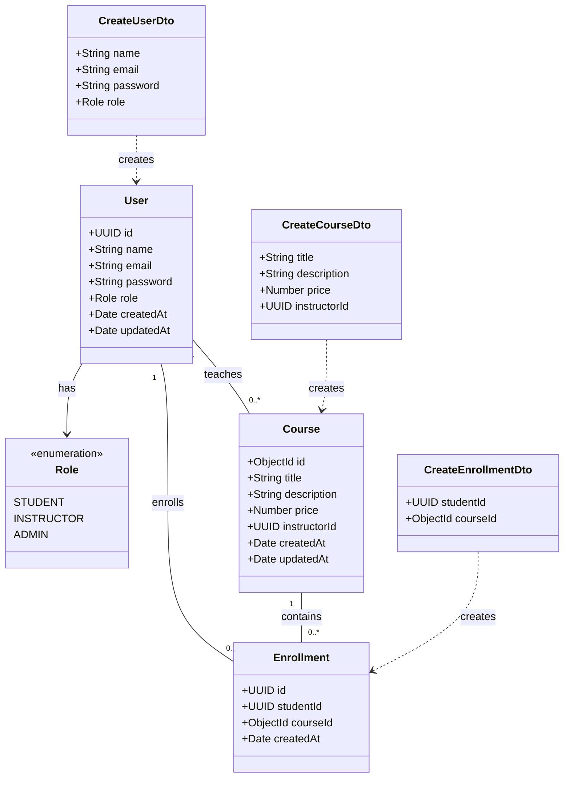
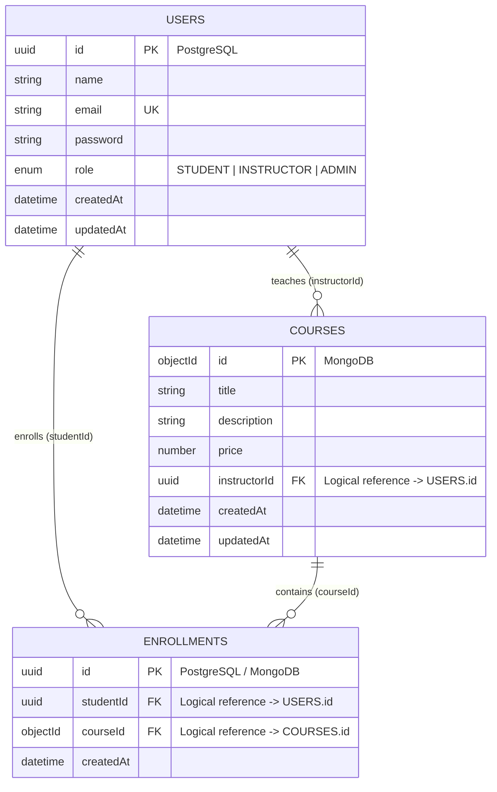
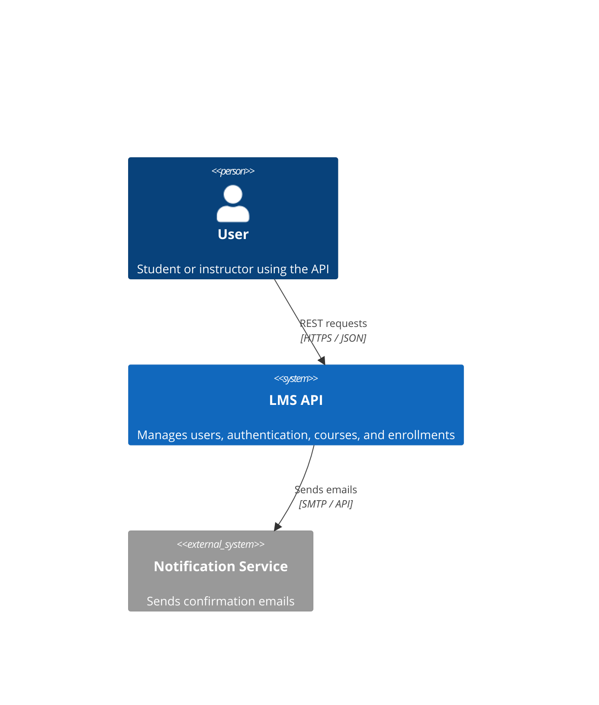
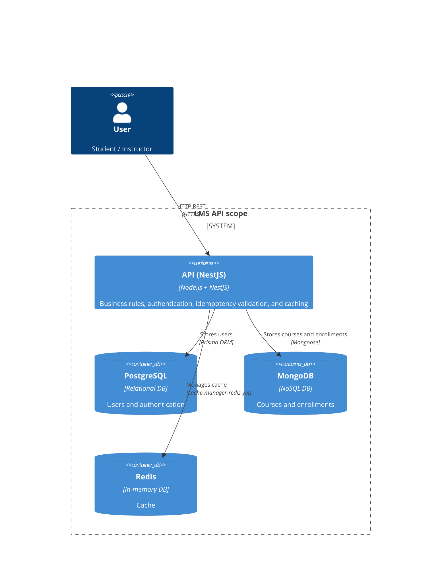
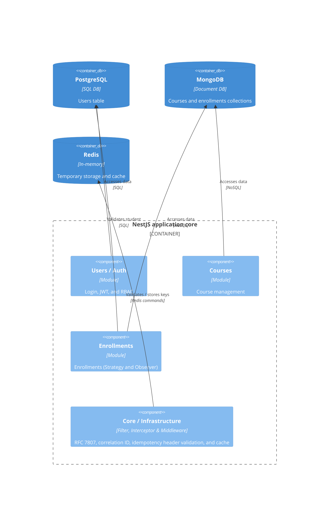

# Data Model and Architecture Diagrams

## 1. UML class diagram

This diagram represents domain entities, enums, input DTOs validated with `class-validator`, and their relationships:

## 2. Entity relationship diagram

Logical view of polyglot persistence across the relational model (PostgreSQL) and document model (MongoDB):

## 3. C4 architecture diagrams

### System context

### Containers

### Components

