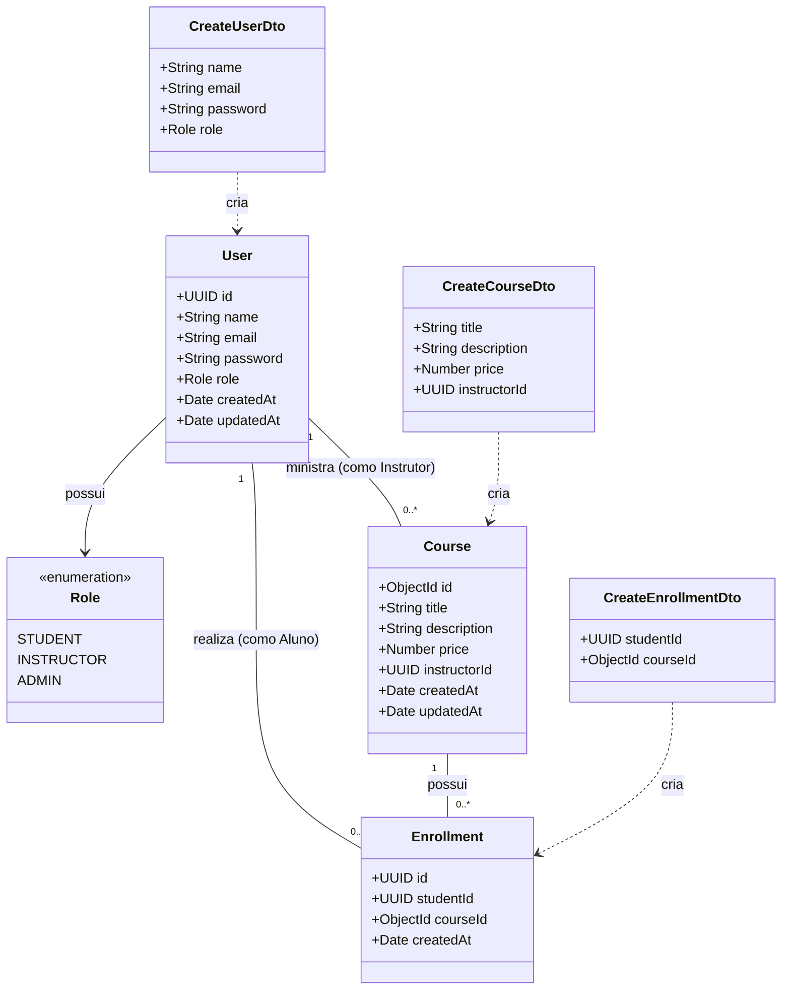
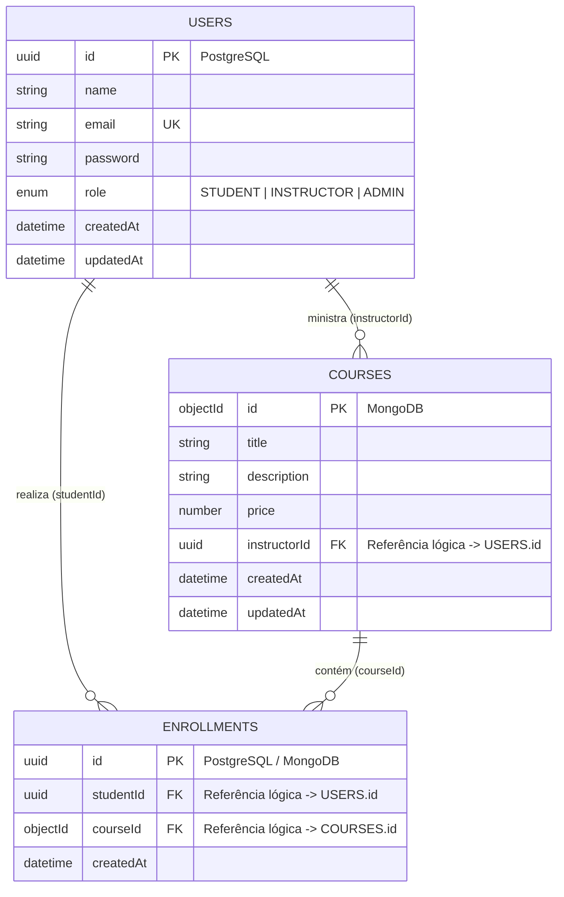
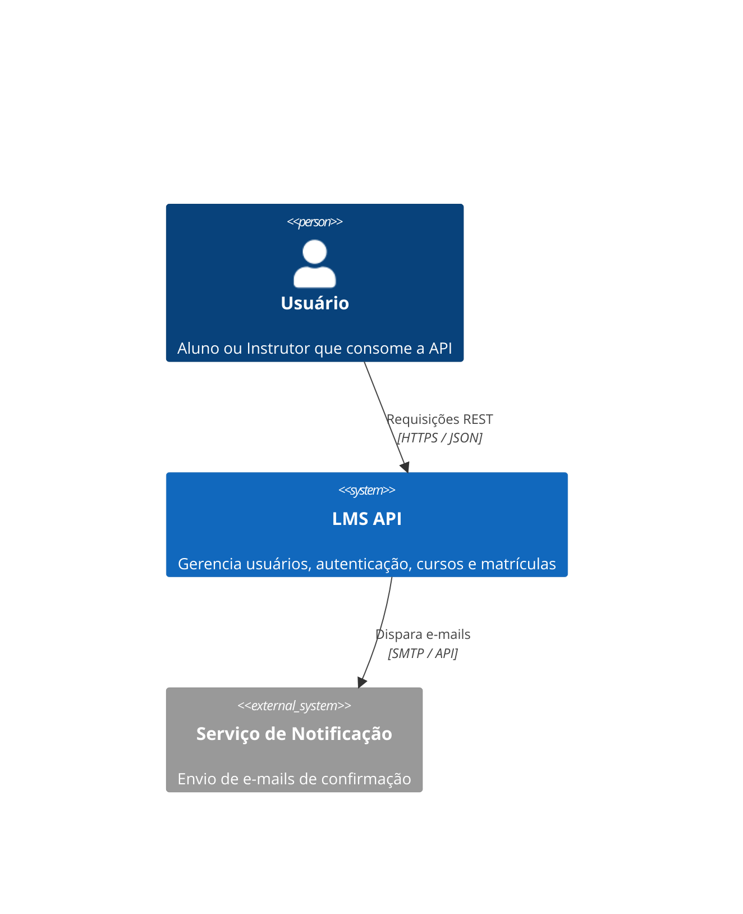
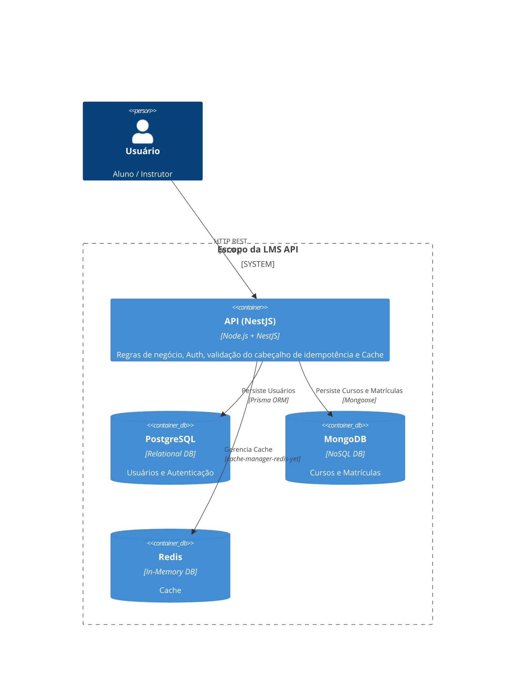
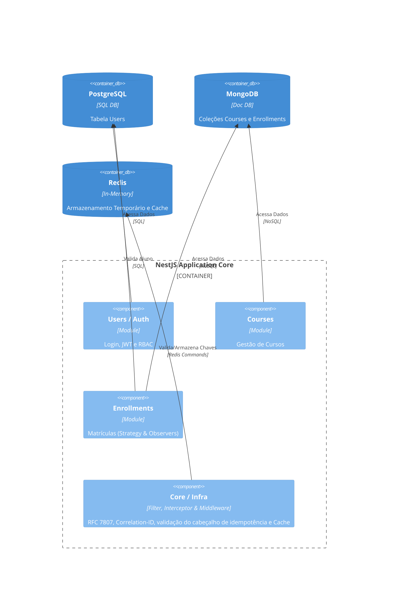

## 📊 Modelagem de Dados

### 1. Diagrama de Classes UML

Diagrama representando as entidades do domínio, enums, DTOs de entrada validados com `class-validator` e seus relacionamentos:

---

### 2. Diagrama Entidade-Relacionamento (DER / ERD)

Visão lógica da integração poliglota entre o modelo relacional (PostgreSQL) e o modelo orientado a documentos (MongoDB):

---

## 🏛️ Documentação Arquitetural (C4 Model)

### 1. Diagrama de Contexto (System Context)

---

### 2. Diagrama de Contêineres (Containers)

---

### 3. Diagrama de Componentes (Components)

---
