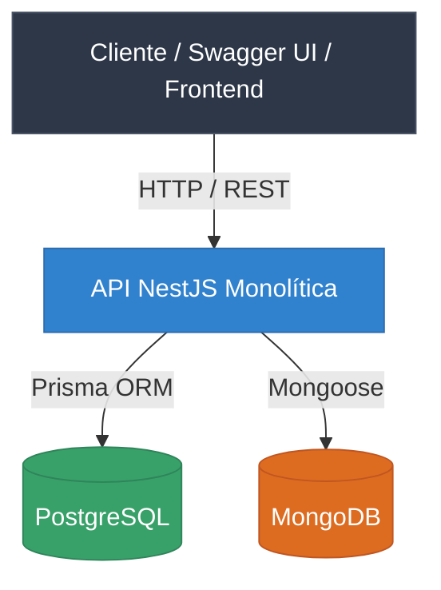
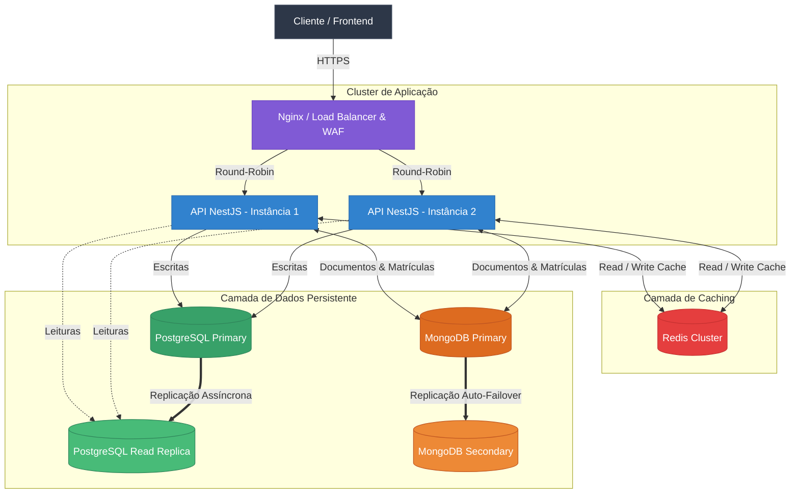

# 📄 Relatório de Otimização da Arquitetura da API (LMS)

---

## 1. Análise da Arquitetura Atual

### Representação do Modelo Atual

Atualmente, a API de Gestão de Aprendizado (LMS) opera sob uma arquitetura monolítica simplificada e containerizada via Docker:

### Principais Componentes:

* **Clientes:** Front-end da aplicação e interface Swagger UI consumindo os endpoints via chamadas HTTP/REST.
* **Aplicação (API NestJS):** Instância única responsável pelo processamento de regras de negócio, autenticação JWT, tratamento de exceções (RFC 7807) e middleware de idempotência.
* **Persistência Poliglota (Bancos de Dados):**
* **PostgreSQL (Prisma ORM):** Armazena dados relacionais de usuários e autenticação.
* **MongoDB (Mongoose):** Armazena documentos de cursos, conteúdos e matrículas.

### Problemas e Riscos Arquiteturais Identificados:

1. **Ponto Único de Falha / SPOF (Disponibilidade e Tolerância a Falhas):** Existe apenas um único contêiner da aplicação NestJS. Caso ocorra um estouro de memória, exceção não tratada no runtime ou falha na infraestrutura, toda a plataforma fica totalmente indisponível.
2. **Gargalo no Banco de Dados Relacional (Desempenho):** Toda verificação de autenticação e consulta de dados consulta diretamente o banco de dados principal. Em cenários de alto tráfego, o excesso de consultas de leitura de dados estáticos gera alto I/O de disco e elevação no tempo de resposta das requisições.
3. **Escalabilidade Limitada e Inexistência de Distribuição de Carga (Escalabilidade):** A ausência de um balanceador de carga impede a distribuição horizontal de tráfego entre múltiplas instâncias da API para lidar com picos de acessos concorrentes.

---

## 2. Proposta da Nova Arquitetura

Para suportar a crescente demanda de usuários, reduzir latências, eliminar pontos únicos de falha e garantir a continuidade do serviço, é proposta a seguinte evolução arquitetural:

### Componentes da Nova Arquitetura:

* **Nginx (Load Balancer & Reverse Proxy):** Atua na borda da aplicação realizando SSL Termination, mitigação básica de segurança (WAF) e distribuição de carga.
* **Cluster da API NestJS:** Instâncias stateless replicadas da API rodando em contêineres independentes.
* **Redis Cluster (Cache em Memória):** Camada de cache distribuído de ultra-baixa latência para gerenciamento de sessões, dados temporários e respostas de rotas com alta leitura.
* **PostgreSQL Primary & Read Replica:** Separação de operações de leitura e escrita para otimização do banco relacional.
* **MongoDB Replica Set:** Cluster com réplica e failover automático para garantia de persistência dos documentos de cursos.

---

## 3. Justificativa das Decisões Arquiteturais

A tabela a seguir apresenta as táticas arquiteturais implementadas na proposta, organizadas pelas quatro categorias exigidas:

| Categoria | Tática Arquitetural | Local de Aplicação | Problema Identificado | Solução Proposta | Benefício Esperado | Risco de Indisponibilidade do Componente |
| --- | --- | --- | --- | --- | --- | --- |
| **Desempenho** | **Cache** | Entre a API NestJS e os Bancos de Dados | Excesso de consultas repetitivas de leitura (cursos, listagens e perfis) elevando o tempo de resposta. | Implementação do **Redis Cluster** para manter dados consultados com frequência armazenados na RAM. | Redução drástica da latência de resposta das requisições e alívio do I/O nos bancos de dados. | Caso o Redis fique fora do ar, a API realiza *fallback* consultando os bancos diretamente (degradação suave do tempo de resposta). |
| **Desempenho** | **Replicação** | Camada de Banco de Dados Relacional (PostgreSQL) | Trava e degradação de performance por concorrência entre operações de leitura e escrita pesadas no PostgreSQL. | Criação de uma **Read Replica** dedicada exclusivamente para rotas de leitura/pesquisa. | Aumento da taxa de vazão de requisições paralelas e isolamento de locks de escrita do fluxo de leitura. | Se a réplica falhar, a API redireciona as consultas de leitura temporariamente para o nó primário. |
| **Disponibilidade** | **Load Balancer** | Entrada / Borda da Aplicação | Ponto único de falha no servidor web e incapacidade de absorver volume expressivo de requisições em 1 nó. | Configuração do **Nginx** como Load Balancer utilizando o algoritmo de distribuição *Round-Robin*. | Distribuição uniforme do tráfego e garantia de que a queda de um container não derrube o serviço. | O Nginx detecta o contêiner inativo via *health check* e desvia 100% do tráfego para os contêineres saudáveis. |
| **Disponibilidade** | **Failover** | Cluster NoSQL (MongoDB Replica Set) | Indisponibilidade total do módulo de cursos e matrículas caso o servidor de MongoDB principal desligue. | Configuração de *Replica Set* com eleição e promoção automática de nó secundário a primário. | Continuidade automática do serviço de armazenamento de documentos sem intervenção humana manual. | Pequena oscilação de milissegundos apenas no período do processo de eleição do novo nó primário. |
| **Resiliência** | **Rate Limiting** | API NestJS (`ThrottlerModule`) | Riscos de sobrecarga maliciosa por ataques de Negação de Serviço (DDoS) ou consumo abusivo de APIs. | Aplicação de limitador de requisições baseado no IP e token do cliente em janelas de tempo. | Preservação dos recursos computacionais da infraestrutura e proteção do sistema contra travamentos. | Requisições legítimas que excederem a cota definida receberão temporariamente a resposta `429 Too Many Requests`. |
| **Resiliência** | **Idempotência** | Interceptors nas rotas de escrita (`POST /courses`, `/enrollments`) | Riscos de duplicidade de registros, criações de cursos ou cobranças devido a retentativas de rede no cliente. | Validação da chave `idempotency-key` presente nos cabeçalhos HTTP da requisição. | Garantia de integridade operacional, impedindo que requisições repetidas afetem o estado da aplicação. | Chamadas duplicadas são bloqueadas retornando o status `409 Conflict` ou o payload original retido. |
| **Segurança** | **RBAC (Role-Based Access Control)** | Guards do NestJS (`RolesGuard`, `JwtAuthGuard`) | Acesso não autorizado a rotas sensíveis e administrativas (ex: estudantes tentando criar cursos). | Aplicação estrita de permissões via tokens JWT vinculados aos perfis dos usuários (`STUDENT` / `INSTRUCTOR`). | Garantia do princípio do menor privilégio e isolamento de segurança das funções do sistema. | Tentativas de acesso sem perfil adequado são barradas na entrada retornando o status `403 Forbidden`. |
| **Segurança** | **WAF / HTTPS Offloading** | Nginx (Reverse Proxy) | Exposição direta do runtime Node.js à internet e vulnerabilidade a ataques como SQL Injection e XSS. | Filtro de tráfego malicioso e rescisão da criptografia TLS/SSL concentrada no Nginx. | Proteção da camada de aplicação e garantia de que todo o tráfego em trânsito trafegue criptografado via HTTPS. | Tráfego malicioso ou malformado é rejeitado na borda sem consumir capacidade computacional da API. |
